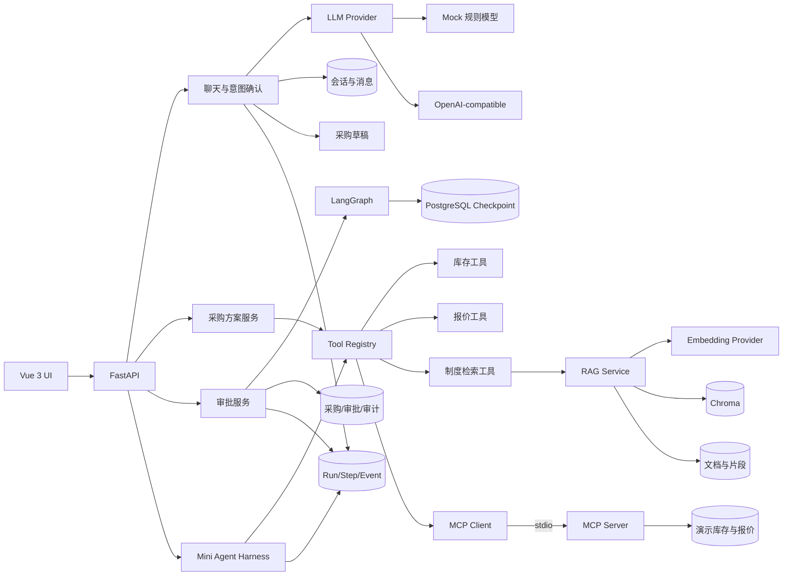

# AI Agent 全链路源码导读

本文解释 Enterprise AI Agent Hub 当前代码如何把 LLM、Embedding、RAG、Tool Calling、
Agent Workflow、LangGraph、MCP、Mini Agent Harness 与多种 Memory 串起来。内容以实际实现
为准，不把规划中的能力描述成已经存在的能力。

## 1. 先给出结论

当前系统不是一个让 LLM 自主决定所有步骤的 ReAct Agent，而是一个面向企业业务的分层、
受控编排系统：

- LLM 负责把当前用户消息抽取为结构化采购意图。
- Pydantic 和服务层负责金额、状态、权限等确定性规则。
- RAG 负责从用户有权访问的制度文档中返回引用证据。
- Tool Registry 把 RAG、库存、报价和 MCP 统一成受控的只读工具。
- 采购方案服务以固定顺序调用工具，当前不由 LLM 自主选工具。
- LangGraph 负责多级审批的暂停、持久化和恢复。
- Mini Agent Harness 负责白名单、限额、超时、有限重试、脱敏和运行轨迹。
- PostgreSQL、Chroma 和 LangGraph checkpoint 分别保存不同类型的“记忆”。

这样设计的核心原因是：模型可以理解和建议，但不能绕过权限、伪造制度、修改金额规则或
直接推动采购状态。

## 2. 总体拓扑



这里没有一条 `LLM -> 直接写数据库` 的路径。模型结果必须经过 Schema、人类确认和确定性
服务层。

## 3. 五条真实调用链

### 3.1 聊天：用户文本 -> LLM -> 结构化意图 -> 人工确认 -> 采购草稿

入口是 `POST /api/v1/chat/sessions/{session_id}/messages`。

```text
Chat API
  -> LLMProvider.extract_purchase_intent(current_message)
  -> PurchaseIntent Pydantic 校验
  -> IntentParseResponse
  -> 保存 USER/ASSISTANT 消息、CHAT run/step/event
  -> 前端展示可编辑意图卡
  -> 用户调用 confirm-intent
  -> ProcurementService.from_confirmed_intent
  -> 创建 DRAFT 采购申请
```

关键代码：

- `backend/app/api/v1/chat.py`：聊天入口、消息持久化、确认边界。
- `backend/app/llm/base.py`：Provider 协议。
- `backend/app/llm/factory.py`：按配置选择 Mock 或远程 Provider。
- `backend/app/llm/mock.py`：无需 Key 的确定性规则抽取。
- `backend/app/llm/openai_compatible.py`：远程模型、JSON 输出和一次修复尝试。
- `backend/app/schemas/chat.py`：不信任模型输出，通过 Pydantic 限制类型、范围和金额。
- `backend/app/services/procurement.py`：确认后才创建业务草稿。

`MockLLMProvider` 虽然名字包含 LLM，但它本质上是正则和确定性规则，用于本地可复现测试。
真实模式与 Mock 模式都必须返回同一个 `IntentParseResponse`，所以后续业务层不关心模型来源。

当前限制：每次意图抽取只传当前消息，没有把历史消息拼入 Prompt。因此数据库中的聊天历史
是持久化会话记录，还不是模型的多轮上下文 Memory。缺字段补充依赖用户在意图卡中编辑，
不是模型自动结合上一轮消息推断。

### 3.2 RAG：文档上传 -> 切块 -> Embedding -> Chroma -> 引用检索

写入链路：

```text
POST /knowledge/documents
  -> ACL WRITE 检查
  -> 文件名/MIME/大小/PDF 签名校验
  -> SHA-256 去重
  -> 原文件落盘
  -> KnowledgeDocument(PENDING)
  -> KnowledgeService.index_document
  -> PDF/TXT/MD 文本提取
  -> 500~800 字符分块并保留页码
  -> EmbeddingProvider.embed_documents
  -> Chroma.upsert(vector + metadata)
  -> PostgreSQL 保存 chunk 原文和 vector_id
  -> Document READY
```

查询链路：

```text
POST /knowledge/search
  -> ACL READ 检查
  -> EmbeddingProvider.embed_query
  -> Chroma 取 top_k * 3 候选
  -> PostgreSQL 回查 READY 文档和 chunk
  -> 最低分数 + 词项交集过滤
  -> 返回文件名、页码、片段和分数
```

关键代码：

- `backend/app/api/v1/knowledge.py`：上传和搜索 HTTP 边界。
- `backend/app/rag/loader.py`：文件安全校验和文本提取。
- `backend/app/rag/chunker.py`：分块与 overlap。
- `backend/app/rag/embedding.py`：Mock 哈希向量或远程 Embedding。
- `backend/app/rag/vector_store.py`：Chroma 适配器。
- `backend/app/rag/service.py`：索引和检索总协调。
- `backend/app/rag/permissions.py`：集合 ACL。
- `backend/app/models/knowledge.py`：文档、片段和向量 ID 的权威元数据。

Chroma 负责相似候选召回，PostgreSQL 负责文档状态、ACL 相关元数据和真实引用文本。删除或
重建文档时两边都必须同步处理。当前回答是基于第一条命中的抽取式模板，不会再调用 LLM
进行生成式答案合成，因此可以清楚追溯答案来自哪个片段。

### 3.3 采购方案：确定性编排 -> Tool Registry -> RAG/库存/报价

入口是 `POST /api/v1/procurements/{request_id}/plan`。

```text
ProcurementService.build_plan
  -> ToolRegistry.invoke("inventory.search")
  -> ToolRegistry.invoke("policy.search") -> KnowledgeService.search
  -> 对每个库存项调用 ToolRegistry.invoke("supplier.quote")
  -> 后端 Decimal 计算并保存 PurchaseCandidate
  -> 返回候选方案、制度引用和工具调用摘要
```

Tool Registry 是最重要的工具信任边界。每次调用都会重新执行：

1. 工具名称白名单检查。
2. 当前用户角色检查。
3. Pydantic 工具参数校验。
4. 单工具超时。
5. 统一输出 `ToolExecution`，记录来源、耗时和结果数量。

`policy.search` 只是 RAG 的工具适配层。它根据当前用户 ACL 选择知识库，再调用
`KnowledgeService.search`。工具调用者不能通过结果文本改变系统指令。

当前 `build_plan` 是固定顺序的业务编排，不是 LLM Tool Calling planner。这样能保证采购
候选和金额可重复、可测试。未来可让 LLM 产生候选 `AgentCall`，但这些调用仍必须经过
Tool Registry 和 Harness。

### 3.4 审批：业务事务 -> LangGraph interrupt -> checkpoint -> 人工决定 -> resume

入口是采购提交和审批决定两个受保护 API。

提交链路：

```text
POST /procurements/{id}/submit
  -> 幂等键与行锁
  -> 确定性审批规则计算审批链
  -> 创建 ApprovalTask、AgentRun、AuditEvent
  -> 构造 GraphState（只放可序列化 ID 和路由状态）
  -> WorkflowRuntime.begin(thread_id)
  -> LangGraph resolve_approval_chain
  -> await_approval 调用 interrupt()
  -> PostgreSQL checkpoint 持久化后暂停
```

恢复链路：

```text
POST /approvals/tasks/{id}/decision
  -> 验证指定审批人、禁止自审、检查当前阶段和幂等键
  -> 事务写 ApprovalDecision、采购状态、AuditEvent、WorkflowResumeEvent
  -> 提交业务事务
  -> WorkflowRuntime.resume(thread_id, validated_decision)
  -> LangGraph Command(resume=...)
  -> 下一审批阶段再次 interrupt，或进入 APPROVED/REJECTED 终点
  -> 更新 AgentRun/AgentStep
```

关键代码：

- `backend/app/agent/state.py`：可序列化 `GraphState`。
- `backend/app/agent/graph.py`：节点、边、`interrupt()` 和 `Command` 路由。
- `backend/app/agent/runtime.py`：图生命周期与 PostgreSQL saver。
- `backend/app/services/approval.py`：业务规则、事务、幂等和图恢复桥梁。

为什么业务表和 checkpoint 都要保存状态？

- 采购申请、审批任务和审批决定是业务事实，必须由服务层和数据库约束保护。
- checkpoint 是工作流执行位置，用来回答“图停在哪个节点、下一步去哪”。
- 恢复时仍要验证业务事实，不能把 checkpoint 当授权依据。

`WorkflowResumeEvent` 类似一个简化的持久化桥梁：审批决定先与恢复事件一起提交，再恢复图。
如果恢复失败，同一幂等键可以重放，不会再次写一份审批决定。

### 3.5 Mini Agent Harness 与 MCP：受限执行器 -> Tool Registry -> 独立工具进程

入口是技术管理页面的 MCP 工具测试 API。

```text
POST /mcp/tools/{tool_id}/test
  -> AgentRunner.run([AgentCall])
  -> 本次运行 allowed_tools 白名单
  -> Registry 角色权限
  -> PostgreSQL ToolPolicy
  -> 步数、调用次数、总超时
  -> ToolRegistry.invoke
  -> MCPClient.call
  -> 启动本地 stdio MCP Server
  -> MCP initialize + 服务身份校验
  -> MCP tool 参数 Schema
  -> 只读数据库查询
  -> 返回结构化结果
  -> 保存 AgentRun/Step/Event 与脱敏摘要
```

关键代码：

- `backend/app/harness/runner.py`：执行循环、限额、授权、重试和轨迹。
- `backend/app/harness/redaction.py`：输入输出摘要脱敏和截断。
- `backend/app/tools/registry.py`：本地/RAG/MCP 统一注册。
- `backend/app/mcp/client.py`：stdio Client、握手、身份校验和错误归一化。
- `backend/app/mcp/server.py`：独立 MCP Server，仅暴露库存和报价只读工具。
- `backend/app/tools/read_service.py`：本地工具与 MCP 工具复用的查询逻辑。
- `backend/app/api/v1/observability.py`：运行详情、步骤、SSE 和 MCP 测试入口。

Harness 当前接收已经规划好的 `list[AgentCall]`，不会自己调用 LLM 生成计划。它是未来自主
Planner 的安全底座，而不是 Planner 本身。只有只读工具允许有限自动重试，避免写操作产生
重复副作用。

## 4. Memory 到底是什么

“Memory”在 Agent 项目里经常被混用。当前系统至少有五种持久化上下文：

| 类型 | 存储 | 主要数据 | 用途 | 会自动进入 LLM Prompt 吗 |
|---|---|---|---|---|
| 会话历史 | PostgreSQL `chat_sessions/chat_messages` | 用户和助手消息、解析 payload | UI 回放、所有权、审计、确认幂等 | 否 |
| 业务状态 | PostgreSQL 采购/审批/审计表 | 草稿、候选、任务、决定、状态 | 业务事实与权限判断 | 否 |
| 工作流 Memory | LangGraph `checkpoint_*` 表 | `GraphState`、当前节点、中断 | 重启后恢复审批图 | 否 |
| 语义知识 Memory | 文件 + PostgreSQL chunks + Chroma | 制度原文、片段、向量 | RAG 证据召回 | 仅检索结果可供业务使用；当前不进入生成式 LLM |
| 运行轨迹 | PostgreSQL `agent_runs/steps/events` | 节点、工具、耗时、错误、SSE | 可观测、诊断、审计 | 否 |

当前没有实现：

- 自动把历史会话压缩后放入 Prompt 的短期记忆。
- 按用户保存偏好、事实或总结的长期个性化记忆。
- Agent 对过去 run 做反思并改变后续规划的 episodic memory。
- LLM 基于 RAG 片段生成综合答案的生成阶段。

因此，“数据被持久化”不等于“模型记住了它”。只有显式读取并放入模型输入的数据才是模型
上下文。当前 LLM 入口只读取本轮消息。

## 5. Agent、Workflow、Harness 的区别

| 概念 | 当前项目中的实现 | 负责什么 | 不负责什么 |
|---|---|---|---|
| LLM Adapter | `app/llm/*` | 意图理解和结构化输出 | 权限、金额、审批状态 |
| Agent Tool | `ToolDefinition` | 一个有 Schema 和权限的能力 | 决定是否可以绕过策略 |
| Agent Workflow | 采购服务 + 审批服务 + LangGraph | 多步骤业务流程 | 任意自由推理 |
| LangGraph | `app/agent/*` | 状态机、中断、恢复、checkpoint | 业务授权和数据库事实 |
| Mini Harness | `AgentRunner` | 安全执行工具调用、限额和追踪 | 自主产生工具计划 |
| MCP | Client/Server 协议边界 | 跨进程发现和调用工具 | 自动授权工具调用者 |

一个完整的企业 Agent 通常可以表示为：

```text
Planner（未来可由 LLM 实现）
  -> 产生候选 AgentCall
  -> Harness 做运行级约束
  -> Tool Registry 做工具级约束
  -> Local/RAG/MCP 执行器
  -> Workflow 根据确定性业务状态决定暂停、继续或结束
```

当前项目已经实现后四层，Planner 仍由固定业务编排或技术测试请求代替。

## 6. 数据关联键

理解这些 ID，就能从一次请求追到全部状态：

- `ChatMessage.run_id -> AgentRun.id`：聊天消息关联解析运行。
- `PurchaseRequest.linked_run_id -> AgentRun.id`：确认意图创建的草稿关联聊天运行。
- `AgentRun.request_id -> PurchaseRequest.id`：审批工作流关联采购申请。
- `AgentRun.graph_thread_id -> LangGraph thread_id`：业务运行关联 checkpoint。
- `ApprovalTask.request_id -> PurchaseRequest.id`：审批任务关联采购申请。
- `WorkflowResumeEvent.run_id/decision_id`：业务审批决定关联图恢复。
- `KnowledgeChunk.vector_id -> Chroma id`：关系库片段关联向量记录。
- `AgentEvent.run_id + seq`：SSE 断点续读。
- HTTP `X-Request-ID -> AuditEvent.request_id`：一次 API 请求关联审计日志。

## 7. 建议的源码阅读顺序

1. `backend/app/api/v1/chat.py`：看一次模型调用怎样变成可确认意图。
2. `backend/app/llm/base.py` 和 `factory.py`：理解 Provider 解耦。
3. `backend/app/schemas/chat.py`：理解模型输出为什么必须再校验。
4. `backend/app/rag/service.py`：分别追踪索引和检索。
5. `backend/app/tools/registry.py`：理解工具的统一信任边界。
6. `backend/app/services/procurement.py::build_plan`：看 RAG 如何成为采购流程中的工具。
7. `backend/app/agent/graph.py`：只关注节点、边、interrupt 和 Command。
8. `backend/app/services/approval.py::submit/decide`：看业务事务如何驱动图。
9. `backend/app/agent/runtime.py`：看 checkpoint thread 如何开始和恢复。
10. `backend/app/harness/runner.py`：看未来 Planner 之下的安全执行层。
11. `backend/app/mcp/client.py` 与 `server.py`：看工具如何跨进程。
12. `backend/app/api/v1/observability.py`：看 run/step/event 如何对外呈现。

## 8. 实际调试练习

### 练习 A：观察 LLM 与会话 Memory

1. 用 `employee` 新建聊天会话并发送采购需求。
2. 在 `chat.py::send_message` 给 `provider.extract_purchase_intent`、`session.commit` 打断点。
3. 对照 `chat_messages`、`agent_runs`、`agent_steps` 和 `agent_events`。
4. 再发一句只包含“用于研发”，观察当前实现不会自动合并上一轮字段。

### 练习 B：观察 RAG 的双存储

1. 用 `admin` 上传 `enterprise_ai_agent_hub_spec/sample_data/policies/知识库上传测试.md`。
2. 在 `KnowledgeService.index_document` 观察 pages、chunks、embeddings 和 vector_ids。
3. 检索“便携式会议摄像头单台限额是多少”。
4. 在 `KnowledgeService.search` 对照 Chroma candidates 和 PostgreSQL rows。

### 练习 C：观察 Tool Calling

1. 创建采购草稿并点击“生成候选方案”。
2. 在 `ProcurementService.build_plan` 观察三个工具的固定调用顺序。
3. 在 `ToolRegistry.invoke` 观察角色检查、Schema 和超时。
4. 在 `policy.search` 进入 RAG，确认检索引用随方案一起返回。

### 练习 D：观察 LangGraph Memory

1. 生成候选并提交审批。
2. 在 `await_approval` 观察 `interrupt()` 返回。
3. 调用 `workflow_runtime.snapshot(graph_thread_id)`，查看 `values/next/interrupts`。
4. 使用 `manager` 审批，观察 `Command(resume=...)` 后进入下一阶段。
5. 使用 `approver` 完成第二级审批，观察图进入 `finalize`。

### 练习 E：观察 Harness 与 MCP

1. 使用 `techadmin` 打开 MCP 工具中心。
2. 测试 `mcp.inventory.search`。
3. 在 `AgentRunner._authorize` 观察三层授权。
4. 在 `MCPClient.call` 观察 stdio 握手、身份校验和结构化返回。
5. 在运行中心查看对应 run、step 和 SSE event。

## 9. Mock 与真实模型切换

相关配置在 `backend/app/core/config.py` 和 `.env.example`：

```text
MODEL_PROVIDER=mock | openai_compatible
EMBEDDING_PROVIDER=mock | remote
```

切换 Provider 只改变“如何得到结构化意图/向量”，不会改变权限、金额、审批和工具策略。
这是 Adapter 层的价值：外部模型是可替换依赖，企业业务规则不是 Prompt。

## 10. 下一步演进方向

如果要进一步实现真正的多轮、自主 Agent，建议按以下顺序推进：

1. 增加受 token 预算约束的会话上下文构建器，并明确哪些历史消息可进入 Prompt。
2. 增加 Planner 输出 Schema，例如 `PlanStep(tool_name, arguments, reason)`。
3. Planner 只能从 Tool Registry 暴露的 Schema 中选择工具。
4. 让 Planner 产出的调用全部经过现有 AgentRunner，不新增绕过路径。
5. 将 RAG 引用作为 LLM 合成答案的上下文，同时验证引用 ID 和 ACL。
6. 为计划循环增加终止条件、最大步数、总 token/时间预算和人工确认点。
7. 若增加长期用户记忆，必须支持来源、过期、纠错、删除和权限隔离。

现有架构已经提供 Provider、工具边界、Harness、checkpoint、审计和运行轨迹，可以在不削弱
确定性业务规则的前提下扩展 Planner 与真正的模型上下文 Memory。
